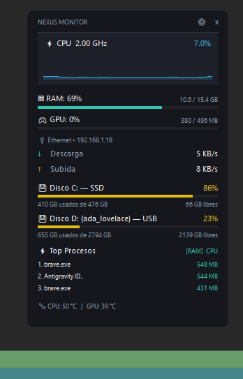
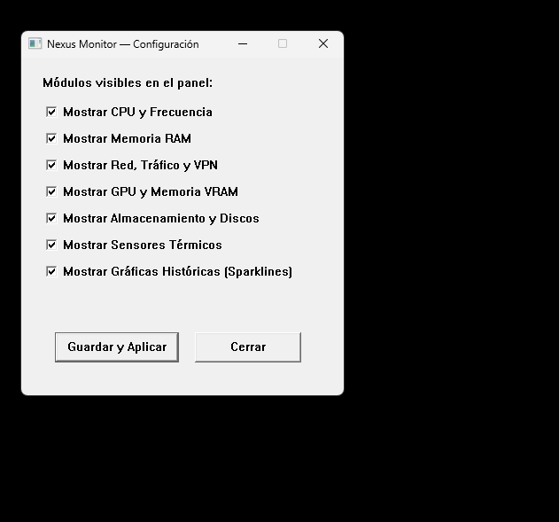
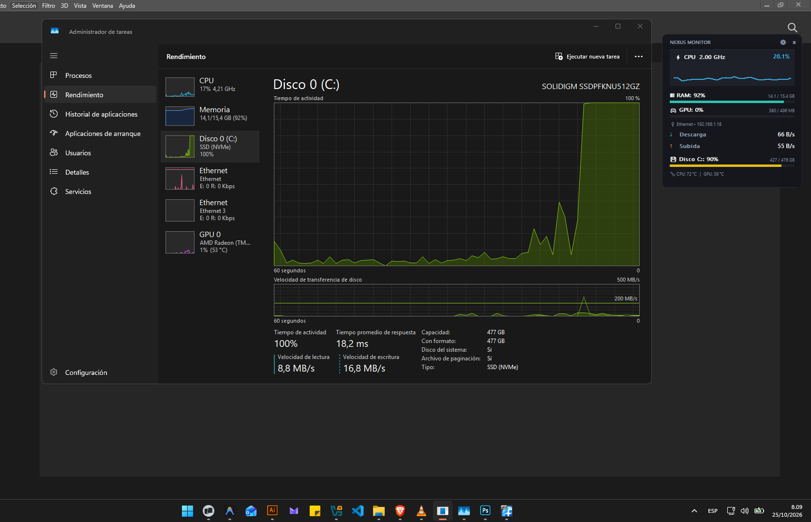
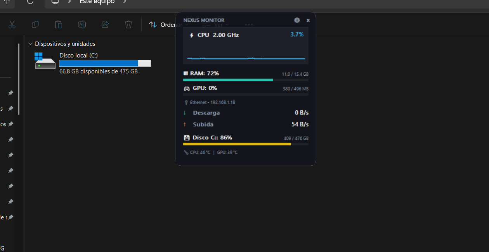

# Nexus Monitor

<div align="center">


**A high-performance, borderless desktop hardware monitor for Windows, engineered in native Rust with pure Win32 APIs and zero webview overhead.**

<br />



</div>

---

## Overview

**Nexus Monitor** is an ultra-lightweight, visually refined desktop system monitor designed for Windows 10 and Windows 11. Unlike conventional Electron-based widgets or bloated background utilities, Nexus is crafted from the ground up using **pure Rust** and direct **Windows Win32 APIs** with hardware double-buffered GDI rendering.

It provides real-time insights into your CPU, RAM, GPU, Network throughput, Drive volumes (including dynamic USB detection), Thermal sensors, and Top Resource-Consuming Processes—all packed into a discreet, translucent graphite panel that seamlessly floats on your desktop.

---

## Visual Gallery

<div align="center">
<table>
  <tr>
    <td align="center"><b>Native Settings Window</b></td>
    <td align="center"><b>Task Manager Real-Time Accuracy</b></td>
  </tr>
  <tr>
    <td align="center"></td>
    <td align="center"></td>
  </tr>
  <tr>
    <td colspan="2" align="center"><b>Desktop Environment Integration</b></td>
  </tr>
  <tr>
    <td colspan="2" align="center"></td>
  </tr>
</table>
</div>

---

## Key Features

- **Extreme Resource Efficiency:** Consistently operates at **< 0.5% CPU** and **~35 MB RAM** (Working Set), ensuring your gaming, streaming, or development workloads remain completely unaffected.
- **Intelligent Auto-Hiding Top Bar:** By default, the top title bar remains completely hidden, allowing metrics to render right up to the top edge (`y = 10 px`) without wasting vertical space. Resting the cursor on the top edge (0–6 px) for **1 second** smoothly reveals the top controls (`[⚙]` Settings and `[✕]` Close). Moving away hides it after a 600 ms grace period, and the bar stays locked visible whenever the settings dialog is open.
- **Pure Win32 & GDI Architecture:** Zero web frameworks, zero Electron runtimes, zero auxiliary background polling scripts. Uses `CreateCompatibleDC` and `BitBlt` double buffering for flicker-free 60 FPS updates.
- **Single-Instance Enforcement:** Protected by a native session-level named mutex (`Local\NexusMonitorSingleInstanceMutex`). Attempting to launch a second instance instantly brings the existing window to the foreground and terminates cleanly.
- **Per-User Windows Autostart:** Seamless integration with `HKEY_CURRENT_USER\Software\Microsoft\Windows\CurrentVersion\Run`. Toggleable on the fly through the visual settings menu without requiring administrative elevation (UAC).
- **Persistent Geometry & Settings:** Remembers its position across reboots and saves configuration directly to a local, user-editable `nexus.toml`.

---

## Monitoring Modules

| Module | Description | Implementation Details |
| :--- | :--- | :--- |
| **CPU Engine** | Total CPU usage %, base/turbo frequency (GHz), and a 28-sample sparkline history curve. | Queried via `NtQuerySystemInformation` / `GetSystemTimes` and Windows PDH counters. |
| **Memory (RAM)** | Used GB, total capacity GB, and percentage with a dynamic dual-color progress bar. | Real-time memory metrics via `GlobalMemoryStatusEx`. |
| **GPU & VRAM** | GPU load percentage, dedicated/shared video memory usage, and core temperature. | Interrogated directly via DXGI hardware adapter interfaces and driver telemetry. |
| **Network & VPN** | Active network interface (Ethernet/Wi-Fi), local IPv4 address, and differential download/upload transfer rates. Detects VPN adapters. | Windows IP Helper API (`GetAdaptersAddresses`, `GetIfTable2`) computing true byte-delta rates per second. |
| **Dynamic Storage** | Real-time capacity, usage bar, free space, and device classification for all mounted drives (Internal SSD/HDD, external USB media). | Dynamic volume discovery via `GetLogicalDriveStringsW`, `GetVolumeInformationW`, and `GetDiskFreeSpaceExW`. |
| **Top 3 Processes** | Tracks the 3 most demanding running applications with an interactive one-click toggle between **[RAM]** (MB) and **[CPU]** (%). | System process snapshot enumeration using `CreateToolhelp32Snapshot` and `K32GetProcessMemoryInfo`. |
| **Thermal Zones** | Real-time thermal telemetry for CPU and GPU cores in degrees Celsius (°C). | Querying ACPI thermal zones via WMI/CIM and GPU vendor thermal interfaces. |

---

## Storage & Dynamic Drive Detection

Nexus Monitor automatically enumerates and classifies storage devices without restarting:
- **Internal Drives:** Detects NVMe and SATA Solid State Drives (SSD) and Hard Disk Drives (HDD).
- **Removable Media & USB:** Identifies USB thumb drives, external enclosures, and SD cards upon connection, displaying their volume label (e.g. `(ada_lovelace) — USB`), utilized space, and remaining free gigabytes.
- **Automatic Overflow Protection:** Text labels automatically truncate cleanly to prevent overlaps on varying screen resolutions.

---

## Top Processes Tracking

The **Top Procesos** module identifies resource hogs in real time:
- **RAM Mode (`[RAM]`):** Sorts all userland processes by private Working Set footprint, displaying the process executable name and memory consumed in megabytes (MB).
- **CPU Mode (`[CPU]`):** Calculates delta execution time across scheduler ticks, displaying the top three CPU-intensive processes.
- **Interactive Switching:** Click the mode indicator header (`[RAM] CPU`) directly on the widget to switch sorting criteria instantly.

---

## Technology Stack & Architecture

```
Nexus Monitor
├── Presentation Layer (GDI double-buffered Win32 window)
│   ├── Window Procedure (wnd_proc, WM_PAINT, WM_NCHITTEST, WM_MOUSELEAVE)
│   ├── Floating Overlay Header (Intelligent 1s hover reveal)
│   └── Native Win32 Config Dialog (ui_config.rs)
├── Metric Collection Engines (Asynchronous & low-overhead)
│   ├── CPU & RAM (metrics.rs)
│   ├── Storage & Drives (disks.rs)
│   ├── Network & IP Helper (network.rs)
│   ├── GPU & DXGI (gpu.rs)
│   ├── Thermal Zones (temperature.rs)
│   └── Process Snapshots (processes.rs)
└── OS Integration & Persistence
    ├── HKCU Run Autostart (autostart.rs)
    ├── TOML Persistence relative to EXE (config.rs)
    └── Single-Instance Named Mutex (main.rs)
```

- **Language:** Rust (2024 Edition)
- **Windows Bindings:** `windows-sys 0.59` (`Win32_Graphics_Gdi`, `Win32_System_Performance`, `Win32_NetworkManagement_IpHelper`, `Win32_Storage_FileSystem`, `Win32_System_Registry`)
- **Serialization:** `serde` & `toml`
- **Installer:** Inno Setup 6 (LZMA2 ultra compression, per-user unprivileged setup)

---

## Prerequisites & Building

### Prerequisites
1. **Windows 10 / 11** (64-bit architecture).
2. **Rust Toolchain:** Install via [rustup.rs](https://rustup.rs/) (supports stable `msvc`).
3. *(Optional)* **Inno Setup 6:** Required only if compiling the Windows installer package (`installer.iss`).

### Clone & Run

```powershell
# 1. Clone the repository
git clone https://github.com/leonukeg/NEXUS_MONITOR.git
cd NEXUS_MONITOR

# 2. Check compilation
cargo check

# 3. Build optimized release binary
cargo build --release

# 4. Run Nexus Monitor
.\target\release\Nexus.exe
```

### Compiling the Windows Installer
If you have Inno Setup 6 installed:

```powershell
& "C:\Program Files (x86)\Inno Setup 6\iscc.exe" installer.iss
# The output setup file will be created in:
# dist\NexusMonitor_Setup_v0.4.0.exe
```

---

## Configuration (`nexus.toml`)

Nexus Monitor generates and reads `nexus.toml` placed next to the executable. A sample configuration:

```toml
[ventana]
posicion_x = 1587       # Horizontal screen coordinate (-1 for automatic right alignment)
posicion_y = 35         # Vertical screen coordinate
opacidad = 230          # Alpha translucency (0-255, where 230 = ~90% opacity)

[modulos]
mostrar_cpu = true
mostrar_ram = true
mostrar_red = true
mostrar_gpu = true
mostrar_discos = true
mostrar_temperaturas = true
mostrar_graficas = true
mostrar_top_procesos = true
modo_top_procesos = "ram"   # "ram" or "cpu"

[comportamiento]
longitud_historial = 28
intervalo_actualizacion_ms = 1000
iniciar_con_windows = true   # Syncs with HKCU autostart registry

[colores]
fondo = "#14151C"
fondo_tarjeta = "#1E202A"
borde = "#2B2E3C"
acento_cpu = "#38BDF8"
acento_cpu_alto = "#FB923C"
acento_ram = "#2DD4BF"
acento_ram_alto = "#F43F5E"
acento_descarga = "#2DD4BF"
acento_subida = "#FB923C"
acento_gpu = "#C084FC"
acento_disco = "#FACC15"
texto_principal = "#FFFFFF"
texto_secundario = "#94A3B8"

[tipografia]
fuente = "Segoe UI"
tamano_base = 13
```

All module visibility and autostart preferences can also be toggled visually by clicking the **`[⚙]` Settings** icon on the floating header.

---

## Known Limitations & Hardware Variance

- **Thermal Sensor Support:** CPU and motherboard thermal queries rely on motherboard ACPI driver support exposed via WMI (`MSAcpi_ThermalZoneTemperature`) or vendor drivers. On certain virtualization environments or proprietary OEM motherboards lacking standard ACPI thermal interfaces, CPU temperature readouts may gracefully fallback or display ambient GPU readings.
- **Multi-GPU Systems:** Nexus currently prioritizes the primary display adapter detected via DXGI. Multi-GPU enumeration (e.g. discrete GPU alongside integrated APU) is slated for upcoming versions.
- **SmartScreen / Windows Defender:** As with any freshly compiled independent open-source binary, Windows SmartScreen may present an informational notice on first launch until the binary establishes reputation or is code-signed.

---

## Roadmap

- [ ] **Multi-Monitor Display Selector:** Dropdown menu to easily anchor Nexus to secondary or tertiary monitors.
- [ ] **Per-Core CPU Matrix:** Expandable drawer displaying individual logical core utilization.
- [ ] **I/O Disk Throughput Sparklines:** Real-time MB/s read/write curves for high-demand drives.
- [ ] **System Tray Icon (Systray):** Optional minimize-to-tray mode with context menu controls.
- [ ] **Custom Theme Presets:** Pre-bundled visual styles (Nord, Catppuccin Mocha, Cyberpunk Amber).

---

## Issues & Contributions

Contributions, bug reports, and suggestions are welcome!
- If you find an issue or have a feature suggestion, please open an issue on the [GitHub Issues](https://github.com/leonukeg/NEXUS_MONITOR/issues) tracker.
- Pull requests are appreciated—please make sure code compiles cleanly with `cargo check` and conforms to standard Rust formatting (`cargo fmt`).

---

## License

Nexus Monitor is free software: you can redistribute it and/or modify it under the terms of the **GNU General Public License** as published by the Free Software Foundation, either version 3 of the License, or (at your option) any later version ([`GPL-3.0-or-later`](LICENSE)).

### Rights & Obligations
- **Freedoms:** You are granted the freedom to run, inspect, share, study, and modify this software for any purpose.
- **Copyleft (Reciprocity):** If you distribute modified versions or binaries of Nexus Monitor, you must make the corresponding complete machine-readable source code available to recipients under the same GNU GPL license terms.
- **Tivoization & Patent Protection:** GPLv3 guarantees protection against patent retaliation and prohibits hardware vendor restrictions that prevent users from running modified binaries on their hardware.
- **No Warranty:** This program is distributed in the hope that it will be useful, but WITHOUT ANY WARRANTY; without even the implied warranty of MERCHANTABILITY or FITNESS FOR A PARTICULAR PURPOSE.

For complete legal terms and conditions, consult the official [`LICENSE`](LICENSE) file.

### Third-Party Components & Attributions
Nexus Monitor utilizes direct Win32 bindings and serialization libraries (`windows-sys`, `serde`, `toml`) licensed under permissive open-source terms (**MIT** and **Apache-2.0**). These third-party components remain subject to their original copyright notices and permissive terms, which are fully compatible with and respected by the GNU GPL v3 license.
